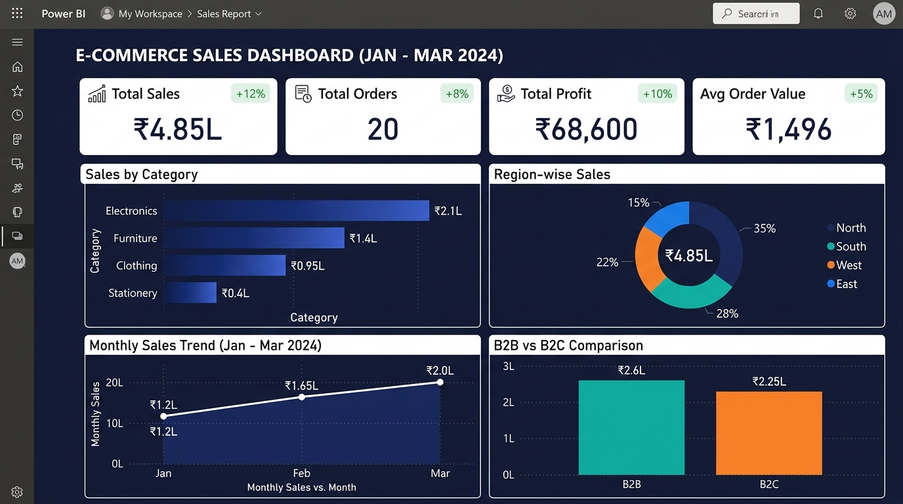

# E-Commerce Sales Analysis Dashboard (Power BI)

A sales analysis dashboard built in Power BI Desktop to analyze e-commerce performance across product categories, customer segments, and regions over a 4-year period.

## Dashboard Preview

## Overview

I created this project to practice end-to-end dashboard design in Power BI. The goal was to take raw transaction data, clean it, model it, and build an interactive report that helps understand business performance and profitability.

## Dataset

- **Source:** Superstore Sales Dataset from [Kaggle](https://www.kaggle.com/datasets/vivek468/superstore-dataset-final)
- **Size:** 9,994 records across 4 years of retail transactions
- The full dataset is included in the `data/sales_data.csv` file.

## Tools & Techniques Used

- **Power BI Desktop:** Report building, cards, slicers, and interactive visuals
- **Power Query:** Data cleaning, type conversion, and date formatting
- **DAX Measures:** Calculated fields for Total Sales, Total Profit, Profit Margin %, and Order Count
- **Microsoft Excel:** I also validated the numbers and created summary tables in `Superstore_Analysis.xlsx`.

## Key Findings from the Data

- **Top Performing Category:** Technology generated the highest total profit, driven by strong margins in phones and accessories.
- **Low Margin Area:** Furniture had steady sales volume but lower overall profit margins due to higher shipping costs and heavy discounts on tables and bookcases.
- **Regional Contribution:** The West and East regions accounted for over 60% of total revenue and profit.
- **Seasonality:** Sales consistently peaked in Q4 (September to December) each year, likely due to festive and holiday shopping.

## Files in this Repo

- `data/sales_data.csv` - Raw transaction dataset from Kaggle
- `Superstore_Analysis.xlsx` - Excel workbook with summary tables and basic pivot charts
- `screenshots/dashboard_preview.jpg` - Preview screenshot of the final Power BI dashboard
